# photonics-deep-learning

Computational electromagnetics and deep learning for photonics, with Bayesian methods, in JAX.

The repository has two parts so far:

- **A Bayesian inverse-scattering testbed** (`src/bayes_scatter`, with `scripts/` and `results/`): a
  differentiable 2-D forward model and Markov chain Monte Carlo that put uncertainties on the
  reconstruction of a scatterer's permittivity. Most of this README describes it.
- **Exploratory notebooks** in [`notebooks/`](notebooks/README.md), one folder per topic. The first
  topic is invisibility and cloaking; Mie scattering and other topics are planned.

Deep learning is, so far, an object of study rather than a tool: the testbed follows a chapter of a
book on AI and deep learning in electromagnetics, and [results/SPAN_TEST.md](results/SPAN_TEST.md)
tests that chapter's network-based reconstruction. No network is trained in the repository yet;
learned priors and a neural surrogate for the forward model are among the later milestones in
[docs/DESIGN.md](docs/DESIGN.md), section 10.

## Gallery

A selection of results, each with the notebook or report it comes from. The first eight items are
outputs of the notebooks in [`notebooks/cloaking/`](notebooks/cloaking/README.md), rendered at a
higher resolution and otherwise unchanged. Those notebooks follow Leonhardt and Philbin,
*Geometry and Light: The Science of Invisibility* (Dover, 2010). The last two items come from the
Bayesian testbed itself.

Lengths are in free-space wavelengths, so the wavenumber is k0 = 2 pi, except in the two
ray-optics items, which use the lens radius and the circle radius a. Every wave result is
two-dimensional, at one frequency and for one polarization, with the electric field E_z along the
invariant (z) axis. The one exception, a scalar-wave result for a sphere, is marked where it
appears.

### Invisibility and cloaking

#### Rays through four classic lenses

<p align="center">
  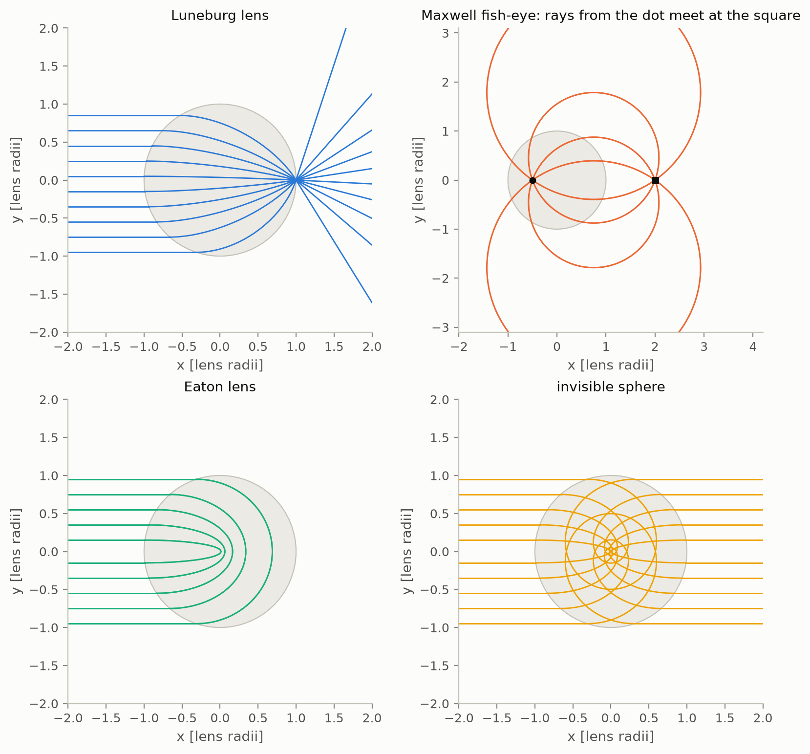
</p>

*Rays traced through four graded-index media, with lengths in lens radii; the gray disk is the
unit circle. Luneburg lens: parallel rays meet at one point on the rim. Maxwell's fish-eye, here
filling the whole plane: rays from the dot at (-0.5, 0) are circles that meet again at the square
at (2, 0). Eaton lens: every ray is turned around and leaves antiparallel to its incoming
direction. Invisible sphere: every ray turns through a full circle inside and leaves on the
continuation of its incoming line.*

One ray tracer handles all four profiles. It integrates the ray equation that follows from
Fermat's principle, written as Newton's law for a unit mass, d^2 r / d xi^2 = grad(n^2 / 2), where
n is the refractive index and d xi = dl / n along the path. The integrator is an adaptive
Runge-Kutta method, and the gradient of n^2 comes from automatic differentiation. The Eaton lens
and the invisible sphere have an index that diverges at the center and need a tighter tolerance.
Each lens is tested on the traced rays against its defining property: the focus on the rim, the
image point, the exit direction and the exit line. The worst error in any of these tests is
6 x 10^-8. The invisible sphere has no hidden region, so it is not a cloak, but it shows that a
medium can send every ray once around its center and still return it to its original line. The
price is a delay: every ray travels an extra optical path of 2 pi lens radii. The same closed-loop
idea reappears on the second sheet of the cloak in the next item.
[Notebook 01](notebooks/cloaking/01_rays_and_invisible_lenses.ipynb), sections 2 and 6.

#### The conformal-map cloak

<p align="center">
  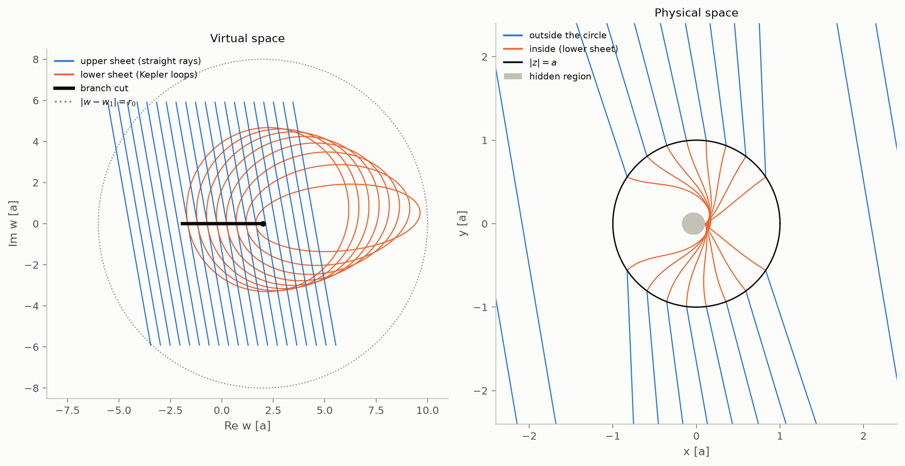
</p>

*Left: virtual space (the w plane), two sheets joined along the branch cut (thick black line).
The dot at its right end is the branch point, a focus of every ellipse. Rays that miss the cut
stay on the upper sheet, where they are straight lines (blue). Rays that hit it pass to the lower
sheet, travel once around a closed ellipse (orange) and return to the point where they entered.
Dotted circle: the farthest a loop can reach. Right: the
same 20 rays in physical space (the z plane), with lengths in units of the circle radius a. Blue:
outside the circle |z| = a. Orange: inside it, where the lower sheet is mapped. Gray: the hidden
region, which no ray can reach.*

This is the conformal-map cloak of Leonhardt (2006), section 5 of Leonhardt and Philbin. The
Zhukovski map
w = z + a^2/z sends the outside of a circle to one sheet of a Riemann surface and the inside to a
second sheet. On the second sheet the notebook constructs an index profile in which rays are
closed Kepler ellipses, so every ray that crosses the cut comes back to its entry point and
continues on its original line. Each step of the construction is checked numerically on 36 sampled
rays. Two things the picture does not tell: the hidden region has only 1.8% of the area of the
disk |z| < a, and every ray through the cut is delayed by the same optical path. The exit rays
carry no trace of that delay, but a wave would see it as a phase step at the edge of the delayed
bundle, at all but discrete frequencies. Waves are not computed in this notebook, and the index
inside the circle is large and varies rapidly.
[Notebook 01](notebooks/cloaking/01_rays_and_invisible_lenses.ipynb), sections 5 and 6.

#### The exact field of the ideal cylindrical cloak

<p align="center">
  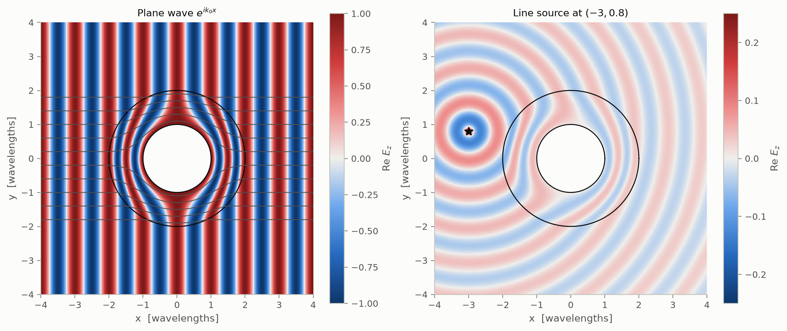
</p>

*Real part of E_z around the ideal cylindrical cloak (inner radius 1 and outer radius 2, black
circles), from the closed-form solution. Left: a plane wave traveling along +x, with ten rays
drawn in gray. Right: a line source at (-3, 0.8), marked by the star. The two panels have
different color scales. The inner disk is blank: the solution has no field there. E_z does not
vanish on the inner circle (red in the left panel), and the next item is about the lining that
this jump requires.*

The cloak is the medium that transformation optics assigns to a radial map of the empty disk r' < 2
(virtual space) onto the shell 1 < r < 2, which sends the origin to the whole inner circle. For this
polarization the field in the shell then comes for free: E_z at a point of the shell is the vacuum
field at the point of the disk that the map sends there. The notebook builds the anisotropic medium
from the Jacobian of the map by automatic differentiation and checks, at 50 random points of the
shell, that the mapped plane wave satisfies the wave equation of that medium to rounding error.
Outside the cloak the field is exactly the field with nothing there, for any source outside the
cloak. Nothing enters the inner disk, provided the inner boundary is the right one, which is the
subject of the next item.
[Notebook 02](notebooks/cloaking/02_transformation_optics_cylindrical_cloak.ipynb), sections 1 and 2.

#### Why the lining of a cloak matters

<p align="center">
  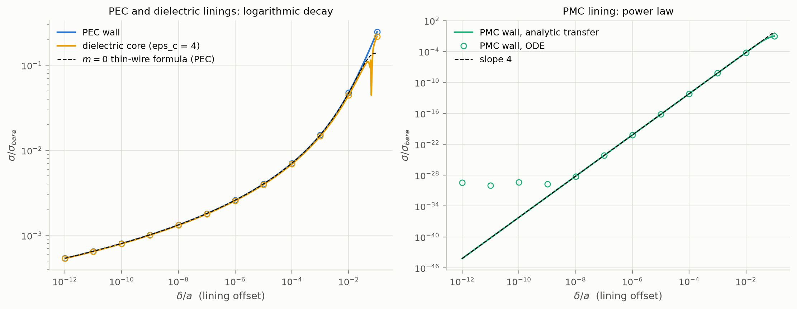
</p>

*Scattering cross-section of the cloak above when it is truncated a distance delta outside its
inner radius a, relative to the bare conducting cylinder of radius a, against delta/a. Lines: the
analytic solution. Circles: a numerical ODE solver. Left: a perfectly conducting (PEC) wall or a
dielectric core of permittivity 4 inside the cloak; dashed, the lowest partial wave of a thin
conducting wire. The narrow dip lies near the size at which the dielectric core acts as a magnetic
wall for that partial wave. Right: a magnetic wall (PMC, a boundary on which the tangential
magnetic field vanishes); dashed, a fourth-power law. For delta/a
below about 10^-8 the ODE solver sits at its rounding floor.*

A real cylindrical cloak cannot reach its inner radius, where the material parameters are
singular. Truncated slightly short of it, with the medium otherwise ideal, the cloak scatters
exactly like a thin object in virtual space, of radius 2 delta for this cloak, and the lining sets
the boundary condition on that object. A conducting wall makes it a thin conducting wire, which
leaves 1.5% of the bare cross-section at delta/a = 10^-3 and still 0.05% at 10^-12: in two
dimensions, for E along the wire, the cross-section of the lowest (angle-independent) partial wave
of a thin conducting wire falls only like 1/ln^2 of its radius. A magnetic
wall is compatible with the ideal field, and the residual then falls with the fourth power of
delta. For this polarization the magnetic wall is what the soft-and-hard-surface lining of
Greenleaf, Kurylev, Lassas and Uhlmann (2007) reduces to.
[Notebook 02](notebooks/cloaking/02_transformation_optics_cylindrical_cloak.ipynb), section 4.

#### A cloak of another shape, in a full-wave solver

<p align="center">
  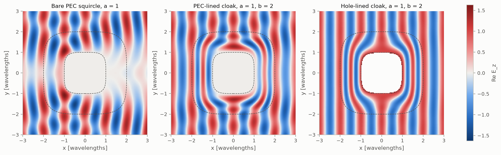
</p>

*Real part of the total E_z from a finite-element solver for a plane wave traveling along +x, at
30 grid points per wavelength, on one color scale. Left: a bare perfectly conducting squircle,
x^4 + y^4 = 1, a square with rounded corners. Middle: the same object inside a cloak with a
conducting lining. Right: a cloak whose inner region is a hole with a magnetic-wall boundary; no
field is computed inside it (white). Dashed lines: the inner and outer boundaries of the cloak,
x^4 + y^4 = a^4 and b^4 with a = 1 and b = 2, drawn in all three panels. In the panel titles PEC
means perfectly conducting and "hole-lined" the magnetic-wall hole.*

The cloak is generated from three ingredients: a coordinate map, its Jacobian from `jax.jacfwd`, and
the transformation-optics formula that turns the Jacobian into the medium. No material tensor is
derived by hand, and the squircle differs from the circular cloak in one line, the function that
defines the shape. The solver uses bilinear finite elements with a perfectly matched layer. At this
resolution it reproduces the exact cross-sections of a dielectric cylinder, a conducting cylinder
and a cylindrical hole to within 5%; it is not validated in the singular region next to the lining.
On this grid the cloak leaves 20% of the cross-section of the bare conducting squircle with the
conducting lining and 2.3% with the magnetic wall, which hides a cavity and not the conducting
object. That ordering agrees with the lining laws above, but the three grids tried (15, 20 and 30
points per wavelength) do not measure those laws: both ratios still fall under refinement, and the
smaller one is comparable to the solver's own error.
[Notebook 03](notebooks/cloaking/03_full_wave_cloaks_and_gauge_freedom.ipynb), section 2.

#### Gauge freedom: two media, the same data

<p align="center">
  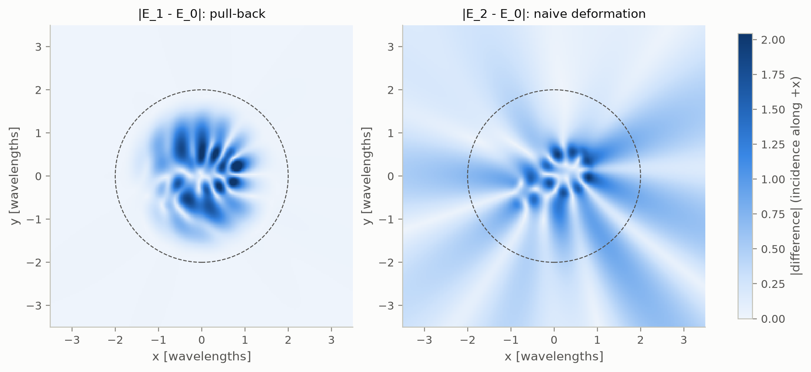
</p>

*Magnitude of the difference between the field E_0 of an isotropic object (two dielectric disks, not
drawn) and the fields E_1 and E_2 of two deformed versions of it, for a plane wave along +x. The
deformation is a twist combined with a 15% dilation, and it tapers smoothly to the identity at the
dashed circle. Left ("pull-back"): permittivity and permeability are both transformed as the change
of coordinates requires, which makes the medium anisotropic; the difference stays inside the circle.
Right ("naive deformation"): only the permittivity map is deformed and the medium stays isotropic;
the difference radiates outward. The panels share one color scale, set by the right panel; the left
panel exceeds it in places.*

For anisotropic media the change of variables behind a cloak is also a non-uniqueness of the
inverse problem, and the cloak is its singular limit. A smooth invertible map that is the identity
outside a disk turns an isotropic medium into an anisotropic one whose field outside the disk is
unchanged, so scattering data measured outside cannot tell the two apart. In the solver, for one
such map, the transformed medium reproduces the data of the original object (plane waves from 8
directions, 60 receivers on a circle of radius 3) to 2.8% on the finest grid, with the difference
falling under refinement, while the naive deformation differs by 77 to 78% on all three grids.
Isotropic nonmagnetic media in two dimensions, the class this project inverts for, have no such
freedom: only a conformal map keeps an isotropic medium isotropic, and a conformal map that is the
identity outside a disk is the identity everywhere. That removes one source of non-uniqueness;
the limits of finite, noisy data remain.
[Notebook 03](notebooks/cloaking/03_full_wave_cloaks_and_gauge_freedom.ipynb), sections 3 and 4.

#### Ray-invisible is not wave-invisible

<p align="center">
  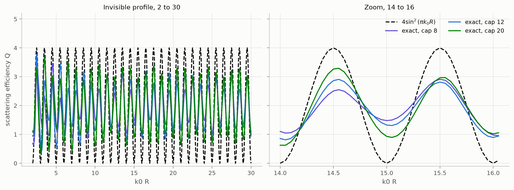
</p>

*Scattering efficiency Q (the scattering cross-section divided by the diameter) of a cylinder of
radius R with the index profile of the invisible sphere, against k0 R, its circumference in
wavelengths, from 2 to 30. Dashed: the semiclassical prediction 4 sin^2(pi k0 R). Solid: exact
solutions with the central index, which diverges, capped at 8, 12 and 20. Right: a zoom on two
periods.*

Rays leave this lens on their original lines, but each is delayed by the same optical path, one
circumference. For waves that delay is one common phase on every partial wave that enters the
lens, while the partial waves that miss it are untouched. So the cylinder should be nearly
invisible when k0 R is an integer and scatter most strongly, with Q = 4, halfway between. With the
center capped at a finite index the exact curves keep the period and never come near zero.
Integrating the radial equation of the uncapped profile directly (not plotted) nearly recovers the
prediction: Q = 0.03 at k0 R = 10 and 3.97 at 10.5, the remainder coming from partial waves at the
edge of the lens. For a sphere, with Q the cross-section divided by pi R^2, the condition is the
opposite one: Q = 3.95 at k0 R = 10 and 0.06 at 10.5 for scalar waves (not plotted either).
Every ray through the lens crosses twice the line through the center along the direction of
incidence. For a sphere that line is a caustic, which a cylinder does not have, and the two
crossings add an extra phase of pi.
[Notebook 04](notebooks/cloaking/04_partial_waves_and_scattering_cancellation.ipynb), section 2.

#### Dielectric cloaks found by optimization

<p align="center">
  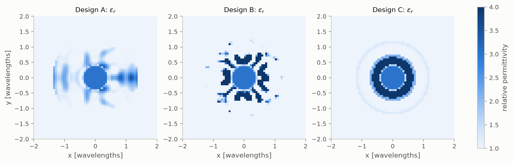
</p>

*Relative permittivity of three shells, out to radius 1.4, designed around a core of radius 0.4 and
permittivity 3 to minimize the energy that core and shell together scatter to 60 receivers on a
circle of radius 4.5, for line sources (transmitters) on a circle of radius 4. A: optimized for one
transmitter, at (4, 0), with every pixel free. B: optimized for all 40 transmitters, with every
pixel free. C: all 40 transmitters, 11 concentric rings. Each shell pixel is confined to values
between 1 and 4.*

<p align="center">
  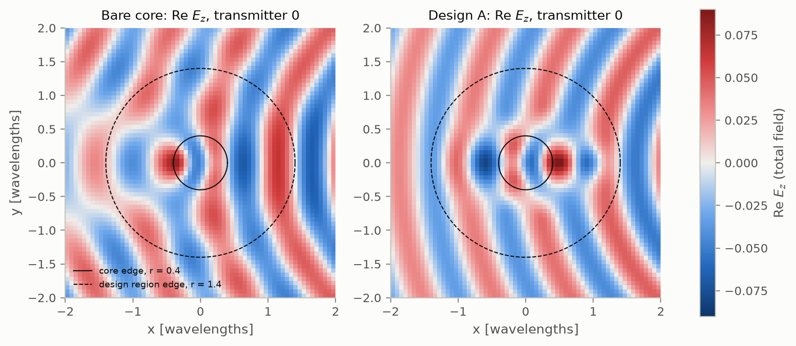
</p>

*Real part of the total field of transmitter 0, the line source at (4, 0). It lies to the right
of the frame, so the wave travels from right to left. Left: the bare core. Right: the core inside
design A. Solid circle: the core. Dashed circle: the edge of the design region. The receivers lie
outside the frame.*

The testbed's forward model is differentiable in the permittivity, so a cloak can be searched for
by gradient-based optimization (L-BFGS-B) of a shell of pixels. For one transmitter at one
wavelength, the energy scattered to the receivers falls by 46.5 dB relative to the bare core on
the grid the design was tuned on. That depth is where the optimizer stopped, and it varies by
several dB between runs. The design is tuned to its grid: with every pixel split in four, so that
the object is the same and only the discretization changes, it keeps 28 dB, which is the size of
the difference between the two discretized models for this design. The same pixels re-tuned on the
finer grid reach 51 dB there. The design also hides the core from one direction only: summed over
all 40 transmitters, design A scatters 2.4 dB more than the bare core. Hiding the core from all 40
transmitters at once is far harder, and the designs found, local optima from one or two starts,
reach 5 to 7 dB. At a signal-to-noise ratio of 30 dB, a test for a known signal against empty
space barely registers design A from its own transmitter (detection index 1.6, the separation of
the two hypotheses in standard deviations) when the data come from the grid it was tuned on; with
data from finer grids the index is 13 to 16. With all 40
transmitters every design is plainly detectable.
[Notebook 05](notebooks/cloaking/05_cloaking_meets_inverse_scattering.ipynb), sections 2 and 5.

### Bayesian inverse scattering

#### A posterior, not only an image

<p align="center">
  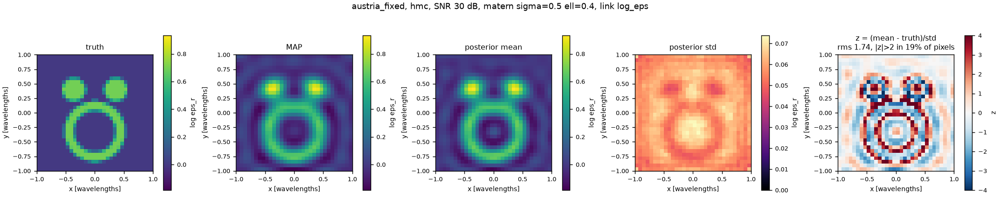
</p>

*The testbed's central output for one test object, two disks and a ring of relative permittivity
eps_r = 2. The data are simulated: 40 transmitters, 60 receivers, a signal-to-noise ratio of
30 dB, computed on a 64 x 64 grid and inverted on a 32 x 32 grid. Left to right: the truth, the
maximum a posteriori estimate (MAP), the posterior mean and the posterior standard deviation, all
in log eps_r (natural logarithm, 0.69 in the object), and the z-score, (mean - truth) / std. The
line above the panels lists the run settings: the name of the test object, the sampler, and the
standard deviation (sigma = 0.5) and correlation length (ell = 0.4 wavelengths) of the prior.*

Hamiltonian Monte Carlo samples the posterior of the permittivity map under a smooth Gaussian
(Matern) prior on log eps_r. It runs in coordinates whitened by the Laplace approximation, a
Gaussian fitted to the posterior at the MAP from Gauss-Newton curvature. Under this prior the
posterior is narrow: its standard deviation in log eps_r is about 0.054 inside the object and
0.060 outside, 0.12 times that of the prior, and it agrees with the Laplace value to better than
1% on average and within 10% pixel by pixel. Yet the mean is smoother than the truth. In 10% of
the pixels of this run the posterior mean is more than three posterior standard deviations from
the truth, against 0.3% for a posterior that covers the truth. Nearly all of them are within one
pixel of an edge: the red and blue rings of the last panel, whose title counts |z| > 2 instead. A
later study ([results/M5_REPORT.md](results/M5_REPORT.md)) attributes the bias of the mean to the
resolution limit of the data, common to every prior tried: the bias map correlates 0.86 to 0.93
with that of the truth low-passed at 3 cycles per wavelength. How many pixels then miss by three
standard deviations depends on the posterior width the prior allows. Convergence is shown only
within the basin of the MAP.
[results/REPORT.md](results/REPORT.md), sections 6 and 7.

#### How close can two disks be?

<p align="center">
  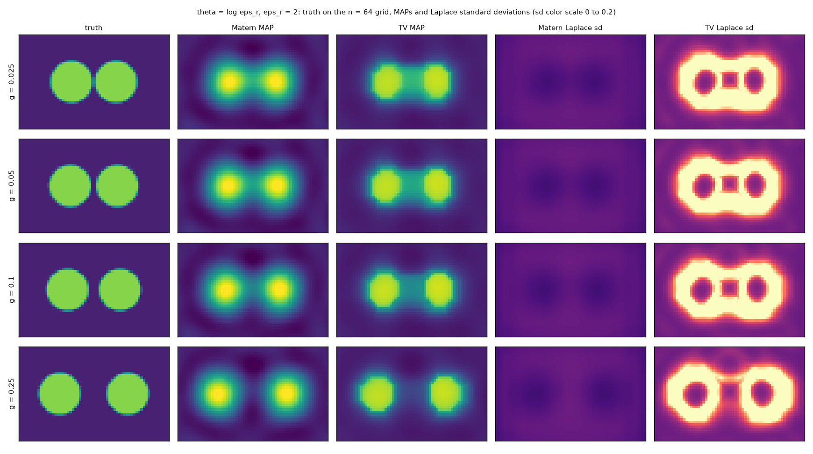
</p>

*Two disks of radius 0.2 and eps_r = 2 with edge-to-edge gaps g of 0.025, 0.05, 0.1 and 0.25
wavelengths (rows), reconstructed on a 64 x 64 grid from simulated 30 dB data. Each panel is 1.44
by 0.9 wavelengths. First three columns, in log eps_r on one scale from -0.09 to 0.87: the truth,
the MAP (maximum a posteriori estimate) under a smooth (Matern) prior, and the MAP under a
total-variation (TV) prior. Last two columns: the posterior standard deviation from the Laplace
approximation (a Gaussian fitted at the MAP) under each prior, on a scale from 0 to 0.2, which the
TV values exceed around the disk edges.*

The question is whether the data show a gap between the disks. The criterion is a posterior
probability above 0.95 that log eps_r in the gap lies below both disks by at least half the
contrast. At the smallest gaps both priors return two maxima joined by a bridge, and they differ
in how deep the valley between them is. From 0.025 to 0.1 wavelengths the verdict depends on the
prior and on how the gap is defined; the narrowest gap that both priors call open is 0.1 to 0.15
wavelengths at this contrast (from the nine gaps of the report, of which the figure shows four).
This is an image-domain limit and not a noise limit: in both MAPs the valley between the disks is
about as deep as in the truth low-passed at 2.5 cycles per wavelength (somewhat shallower under
TV), near the 2 cycles per wavelength that single scattering passes, and the threshold barely
moves when the signal-to-noise ratio is raised by 10 dB. For comparison, if the two-disk shape is
known and only the gap, radius, permittivity and position are estimated, the Cramer-Rao bound on
the standard deviation of the gap estimate equals the gap itself at a gap of 2.6 x 10^-4
wavelengths, 380 to 580 times smaller than the image threshold. The two limits are defined
differently, and their ratio is not a loss factor. The uncertainties here are Gaussian
approximations for one noise realization, and no Markov chain run met the convergence criteria for
this problem.
[results/RESOLUTION_REPORT.md](results/RESOLUTION_REPORT.md).

## The Bayesian testbed

The book chapter the testbed follows (Campbell and Werner, eds., *Advances in Electromagnetics Empowered
by Artificial Intelligence and Deep Learning*, Ch. 15, section 15.4.1.1) reconstructs the permittivity of a
2-D scatterer from multi-static scattering data and reports point estimates only. This package puts a
posterior on the same problem and samples it with MCMC, to see which features of a reconstruction the data
determine and which come from the prior.

Everything is written from scratch in JAX (float64): a Lippmann-Schwinger forward model with FFT-accelerated
pixel Green's functions and an adjoint gradient, Gaussian-field priors on log eps_r in whitened coordinates,
four MCMC samplers (pCN, pCN-Langevin, MALA, HMC), convergence diagnostics, a MAP baseline, and an exact
Gaussian reference posterior (Born model) against which the samplers are validated. The contract for every
module is [docs/DESIGN.md](docs/DESIGN.md).

## Setup

```bash
conda create -n photonics-dl -c conda-forge python=3.12 numpy scipy matplotlib jupyterlab pytest
conda activate photonics-dl
pip install -U jax                   # CPU; for the Linux GPU workstation see docs/WORKSTATION.md
pip install -e ".[dev]"              # from the repository root
```

## Tests

```bash
pytest -q -m "not slow"              # default suite, about 2.5 minutes
pytest -q -m slow                    # one longer Monte Carlo run (tighter agreement with the exact posterior), about 2 minutes
pytest tests/test_born_end_to_end.py -m "not slow" -v   # the key validation (about 45 s)
```

Every test file is named after its module (`test_geometry_phantoms.py`, `test_greens.py`, `test_forward.py`,
`test_gradients.py`, `test_priors.py`, `test_samplers.py`, `test_diagnostics.py`, `test_likelihood.py`,
`test_inference.py`, `test_plotting.py`, `test_scripts.py`) plus `test_born_end_to_end.py`, and, for milestone 4,
`test_mrf.py`, `test_jacobian.py`, `test_thetaspace.py`, `test_features.py`, `test_prior_comparison_scripts.py`,
`test_measure_theta_cost.py` and `test_span_test.py`; for milestone 5, `test_adapt.py` (and the TV prior in `test_mrf.py`, the adapted
runner, the lambda sweep, the re-adapted map, burn-in segments, the slow-mode and cross-run diagnostics in `test_prior_comparison_scripts.py`),
`test_wait_then.py` and `test_segment_loop.py` (job gating and the per-chain segment loop); for its review follow-up, `test_m5_review.py` (low-pass reference, disk-averaged features, corrected independence checks, overdispersed starts, review batch).

## Scripts

| script | what it does |
|---|---|
| `scripts/validate_forward.py` | Mie convergence table, timing and GMRES effort of the forward model, stacked versus vmapped solves, warm starts |
| `scripts/born_exact_check.py` | Born end-to-end check at a larger size: four samplers against the exact Gaussian posterior, z-score table, ESS per second, figure in `results/born_exact/` |
| `scripts/run_posterior.py` | The full pipeline: phantom, data on a finer grid, noise, prior, MAP, MCMC, summaries and figures in `results/<out>/`; also reports the operating point of the inference grid (model error against the noise, Phi at the truth against N) |
| `scripts/run_posterior_laplace.py` | Prototype outside the ladder: the same pipeline with the samplers run in Laplace-whitened coordinates (Gauss-Newton eigenpairs at the MAP, log-normal re-centering). Its sampler trace is the reparametrized Phi', not the misfit; the misfit of the stored draws is reported separately |
| `scripts/map_multistart.py` | MAP from several prior-draw starts: one basin or several |
| `scripts/analyze_run.py`, `scripts/make_tables.py` | Per-run metrics (misfit, ESS, R-hat, z-maps, Laplace reference std) and the Markdown tables / misfit figures in `results/tables/` and `results/figures/` |
| `scripts/measure_cost.py`, `scripts/plot_gn_spectrum.py` | Cost per evaluation on the benchmark configurations; Gauss-Newton spectrum figure |
| `scripts/run_prior_comparison.py` | Milestone 4 (DESIGN 11): ONE prior (`matern`, `gmrf`, `qggmrf`, and `tv`, the pseudo-Huber TV prior of milestone 5) on the shared moderate problem in theta = log eps_r: smooth start, L-BFGS-B MAP, dense Laplace mass from the exact reciprocity Jacobian, HMC in Laplace-whitened coordinates, convergence verdict, feature probabilities; writes `results/prior_comparison/<out>/` (`summary.json` with the d_obs hash and thread environment, `chains.npz`, `maps.png`); `--stage prepare / chain / finalize` splits it into one process per chain with continuation segments; `--adapt` (milestone 5, DESIGN 12.2) adds `--stage adapt` and samples in the coordinates of an affine map adapted in expanding warmup windows and frozen before recording (`adapted_map.npz`, `adaptation.json`). Two runs have the same data if max abs(d_a - d_b) / s <= 1e-6; the hash alone is not the criterion (it depends on the XLA thread count) |
| `scripts/make_prior_jobs.py` | Writes `batch_run.py` job files for the staged form of `run_prior_comparison.py` (`--stage prepare`, `adapt`, `chain` with `--segment` for extension, `finalize`): one single-thread process per chain, about 1.8x the throughput per thread of four threads per process (cost.json). Milestone 5 prior names: `tv_lam<value>` and a `_adapt` suffix (`gmrf_adapt`, `tv_lam3.75_adapt`) |
| `scripts/tv_lambda_sweep.py` | Milestone 5 (DESIGN 12.1): the milestone-4 MAP path for the pseudo-Huber TV prior at several lambda; Phi_MAP, R_MAP, the errors, convergence of the MAP and the MAP edge bias per lambda; lambda* by the discrepancy principle (`tv_lambda_sweep.json`, `.png`, `_maps.npz`; `--update` adds lambdas) |
| `scripts/segment_loop.py` | Milestone 5: ONE chain's recorded segments of `run_prior_comparison.py --stage chain`, one process per segment (a segment is the checkpoint: a killed run loses at most the segment in flight; existing segment files are skipped; `--go` / `--stop` files start and end the loop between segments); one `batch_run.py` job per chain |
| `scripts/make_m5_resume.py`, `scripts/make_m5_batch.py`, `scripts/wait_then.py` | Milestone 5 job files: the resume batch of 12 segment loops (adapted GMRF, TV at lambda* and 3 lambda*), the first batch (one process per chain and segment, gated by `wait_then.py` dependency / go / skip files), and the gate itself |
| `scripts/check_chain_starts.py`, `scripts/milestone5_tables.py` | Physical Phi, R and U at the chain starts of an adapted run before the chains are launched; the Markdown tables specific to milestone 5 (lambda sweep, adaptation, sampler, edge statistics with per-chain bias) from the stored JSON files |
| `scripts/make_m5_review_jobs.py`, `scripts/make_overdispersed_starts.py` | Milestone 5 review follow-up (DESIGN 12.6): ONE batch with two more TV posteriors (lambda = 1.25 and 8.5, chains from four different starts: truth, MAP, Matern mean, a rough GMRF draw) and an independent-start replication of lambda* in a new directory; the start maps and their TV prior energy (`starts.npy`, `starts.json`) |
| `scripts/resolution_analysis.py`, `scripts/feature_scales.py`, `scripts/lambda_band.py` | Review follow-up analyses: bias and z of the posterior mean against the low-passed or cell-averaged truth (`bayes_scatter.resolution`); the three features at point and disk-averaged scales, per chain and per block, and for the Laplace approximation without MCMC; the edge statistics of the TV posterior as a function of lambda across the discrepancy band |
| `scripts/equal_length_audit.py`, `scripts/start_drift_audit.py` | Convergence numbers at equal numbers of draws (and per gradient evaluation); block means of \|zeta\|^2 / 2 and the prior energy, and the recorded starts of every chain |
| `scripts/m5_commands_as_run.md`, `scripts/m5_review_analysis.sh` | The commands that were actually run for milestone 5 (including the manual launches), and the analysis commands of the review follow-up |
| `scripts/edge_analysis.py` | Bias, posterior std and z by signed distance to the object edge, an independent recomputation of the |z| statistics from the stored draws, the |z| > 3 fraction of each chain on its own, the bias of log E[eps_r] next to that of E[theta], and the per-draw blur at d = -1 (`edge_analysis.json`, `edge_profile.png`) |
| `scripts/convergence_audit.py` | Rank-normalized bulk / folded split R-hat, multi-chain bulk ESS and the AR(1) null spread of the R-hat statistics, per run, from the stored draws (`convergence_audit.json`) |
| `scripts/prior_energy_audit.py` | Prior energy R and data misfit Phi at the truth, the MAP, the posterior mean and the draws, the same for Gaussian blurs of the truth, and the cost of a log 2 step as a jump or a ramp for the q-GGMRF family (`prior_energy.json`) |
| `scripts/check_data_threads.py` | Builds d_obs at two XLA thread counts in subprocesses and compares hash and numbers (`data_thread_check.json`) |
| `scripts/span_test.py` | Milestone 4 (DESIGN 11.4): the best-in-span lower bound for the book's NMM on held-out Table 15.2 draws and Fig. 15.9-like scenes, an independent second implementation, the P sweep, and the review variants (training eps_r range, clipping, a constant in the span, the metric); writes `results/span_test/`; `--variants-only` adds the variants to stored results |
| `scripts/span_test_tables.py` | Prints the span-test report tables from `results/span_test/span_test.json` (no recomputation) |
| `scripts/_threadcap.py` | Imported first by the standalone scripts: caps the BLAS / OpenMP thread variables at 2 before numpy is imported |
| `scripts/prior_feature_baseline.py` | Prior probabilities of the three DESIGN 11.3 features, the baseline for the posterior probabilities (`prior_features.json`) |
| `scripts/prior_comparison_tables.py` | Prints the report tables from the stored `summary.json` / `comparison.json` files (no recomputation) |
| `scripts/compare_priors.py` | Reads several `run_prior_comparison.py` directories, refuses runs with different data, writes `comparison.json` and the mean / std, disagreement and feature-probability figures |
| `scripts/measure_theta_cost.py` | Cost of U and its gradient, the Jacobian assembly, the Laplace mass and the MAP per prior (milestone 5: the TV prior, the adapted-map potential and one adaptation window update, `cost_tv.json`), at n = 32 and 48 and 1 or 4 XLA threads, one process at a time |

```bash
python scripts/born_exact_check.py                       # about 2.5 min
python scripts/run_posterior.py --n 16 --side 2 --out demo
python scripts/run_posterior.py --n 24 --side 2 --phantom austria_fixed --eps-r 1.5 \
    --sampler hmc --chains 2 --warmup 300 --samples 500 --init map --out austria24
python scripts/run_posterior.py --help                   # all options
```

`run_posterior.py` writes `summary.json` (arguments, acceptance, final step size, ESS and integrated
autocorrelation time of Phi and of five fixed pixels, split R-hat, wall time, forward-solve counts, ESS per
second, the book's error metrics for the MAP and the posterior mean), `chains.npz`, `maps.png` (truth, MAP,
posterior mean, posterior standard deviation, and the z-map (mean - truth)/std, all in eps_r),
`maps_log_eps.png` (the same in log eps_r) and `traces.png`.

## Package layout

```
src/bayes_scatter/
  geometry.py     Grid, Antennas, Setup, ring(), ch15_setup()
  phantoms.py     coverage(), cylinder(), austria_fixed(), ch15_austria_variant()
  greens.py       pixel kernel (Richmond equal-area cells), FFT embedding, receiver matrix, incident fields
  krylov.py       restarted GMRES with per-transmitter tolerances (see forward.py for why)
  forward.py      Forward: apply_G, solve_fields, scattered, __call__ (differentiable), born, born_matrix
  mie.py          analytic cylinder scattering for validation
  priors.py       GaussianField (Matern, GMRF), links (log_eps, identity), compose
  likelihood.py   noise_std_from_snr, add_noise, misfit, Target
  samplers.py     pcn, pcn_langevin, mala, hmc, run_chains, ChainResult
  diagnostics.py  autocorr, tau_int, ess, ess_geyer, mcse_mean, split_rhat
  inference.py    map_estimate, born_gaussian_posterior, err_model/err_chi/err_data, operating_point, sample, compare_to_gaussian,
                  physical_phi_of_draws, laplace_theta_variance, lognormal_center_shift
  validation.py   Born problem builder and sampler comparison shared by the test and the script
  plotting.py     plot_maps, plot_traces, plot_born_check
  mrf.py          theta-space prior energies: QGGMRF (edge-preserving), PseudoHuberTV (milestone 5), GaussianEnergy (Matern / GMRF
                  cropped to the DOI), WhitenedMap, sample_prior (HMC on R alone)
  adapt.py        milestone 5 (DESIGN 12.2): AffineMap, adapt_map (expanding-window map adaptation, dual-averaged step size,
                  variable-length trajectories), update_map (shrinkage toward the Laplace covariance), sample_chain (frozen recording)
  jacobian.py     exact dd/dchi and dd/dtheta by reciprocity (Nt + Nr solves), Gauss-Newton Hessian, jvp check
  thetaspace.py   ThetaTarget (U = Phi + R), LaplaceMass (dense H, Cholesky), ZetaTarget (reparametrized potential), map_theta,
                  smooth_start
  features.py     pooled moments, edge mask, |z| statistics, disagreement, the DESIGN 11.3 feature probabilities (point values, or
                  disk means of a given radius)
  resolution.py   ideal circular low-pass and disk average of a map (the band-limited reference for the posterior mean), Pearson r
```

## Summary of the design

**Conventions.** Lengths in free-space wavelengths (k0 = 2 pi), time dependence e^{-i omega t}, 2-D TM
polarization with u = E_z. Pixel arrays are indexed `[i, j] = [x, y]` and flattened in C order. The contrast
is chi = eps_r - 1.

**Forward model.** The total field of each transmitter solves (I - G diag(chi)) u = u_inc, with G the
block-Toeplitz pixel Green's operator applied by FFT on a 2n x 2n embedding. Each square pixel is replaced
by an equal-area disk, which gives closed forms for the self and off-cell kernels. Data are
d[t, r] = sum_m R[r, m] chi_m u_t[m] for the book's rings: 40 transmitters on a circle of radius 4, 60
receivers on a circle of radius 4.5, a 5 x 5 wavelength domain at n = 96. The solve is differentiable in
chi by the adjoint (implicit-function) gradient, checked against finite differences. The Born
approximation (u replaced by u_inc) makes the data linear in chi.

**Prior.** The parameter is theta = log eps_r, so eps_r = e^theta is log-normal and positive by
construction. theta = mu + C^{1/2} xi with xi ~ N(0, I) (whitened coordinates), C a stationary Matern or
GMRF covariance applied by FFT on a padded torus. mu = 0 is the vacuum background, sigma is in natural-log
units. The identity link chi = theta exists only for linear-Gaussian validation.

**Likelihood.** Circular complex Gaussian noise at a power SNR in dB. The potential is
Phi(xi) = sum |F(chi(xi)) - d_obs|^2 / s^2 and the posterior is pi(xi) proportional to
exp(-Phi(xi)) N(xi; 0, I).

**Samplers.** All four share one callable `phi_fn(xi, aux) -> (phi, grad, aux_new)`: pCN, pCN-Langevin
(infinity-MALA), MALA and HMC, each in `lax.scan`, with Robbins-Monro step-size adaptation during warmup,
Welford statistics, and a warm-start field `aux` that is restored on rejection. `inference.sample` drives
them on a `Target`.

**Inference utilities.** `map_estimate` (Tikhonov MAP by L-BFGS-B), `born_gaussian_posterior` (exact
posterior for the Born model with the identity link), and the book's metrics `err_model` (eq. 15.21, on
eps_r) and `err_data` (eq. 15.22), plus the contrast-normalized `err_chi`, because eq. 15.21 includes the
background eps_r = 1 and compresses errors in fine structure.

## Validation ladder (status)

Numbers are in `results/tables/` and `results/figures/` (commands in `scripts/reproduce_report.sh`); the status says which rungs are built and tested.

| step | check | status | where |
|---|---|---|---|
| 1 | kernel against quadrature (self and off-cell terms) | done | `tests/test_greens.py` |
| 2 | forward against the Mie series, error decreasing under refinement | done | `tests/test_forward.py`, `scripts/validate_forward.py` |
| 3 | gradient against central finite differences | done | `tests/test_gradients.py`; Target level in `tests/test_likelihood.py` |
| 4 | samplers on a known Gaussian, with negative controls | done | `tests/test_samplers.py` |
| 5 | samplers on the exact Born posterior through the physics `Target` | done | `tests/test_born_end_to_end.py`, `scripts/born_exact_check.py` |
| 6 | nonlinear posterior (log_eps link), inverse crime avoided | run at n = 32 (weak and moderate contrast) with the Laplace-whitened samplers; identity-mass samplers did not converge; book scale (n = 48, and n = 96 at 20 dB) is out of reach: the MAP does not converge, see `results/tables/c_book.md` | `scripts/run_posterior.py`, `scripts/run_posterior_laplace.py` |
| 7 | prior sensitivity (Matern versus GMRF, further priors later) | one GMRF control at moderate contrast; edge-preserving priors not done, so no resolution claim yet | `scripts/run_posterior_laplace.py --prior gmrf` |

Step 5 uses a deliberately low SNR (-20 dB per datum) because 2400 complex data multiply the information
about the best-determined directions; see the docstring of `bayes_scatter/validation.py`.

## Known limits

- High contrast is expensive: the forward solver is unpreconditioned GMRES. At n = 96 an eps_r = 2 phantom
  costs about 0.6 s per forward solve, eps_r = 4 about 5 s, and eps_r = 8 does not converge at restart 100.
  Solves that hit the iteration cap are returned silently; `Target.solver_residual` reports the true residual.
- Chains of the full forward model run one after another (`chain_method="sequential"`); vmapping the Krylov
  loops over chains is much slower to compile and run. Batching is used for the Born model.
- Posterior directions that the data determine are far narrower than the prior (condition numbers of
  10^3 to 10^6 in whitened coordinates at realistic SNR), so samplers with an identity mass matrix mix slowly
  in the prior-dominated directions. This is the quantity the ESS per second columns measure.
- The inference grid is itself a source of error. At 30 dB the data noise is 3.2 percent of ||d||; the forward
  model on the coarse inference grid misses the finer-grid data by 0.7 percent (weak cylinder, n = 32), 2.1 percent
  (moderate austria phantom, n = 32; 0.85 percent at n = 48) and 8.0 percent (book scale, side 5, n = 48; 2.6
  percent at n = 96). `run_posterior.py` prints and stores this as `operating_point` (Phi at the truth against N).
- Samplers that run in transformed coordinates (the Laplace-whitened prototype) have a potential that is not the data
  misfit; quote `summary.json["phi_physical"]`, not the sampler trace (`summary.json["phi"]["kind"]` says which).
- Later milestones (Laplace pass, edge-preserving and learned priors, delayed acceptance, replica exchange,
  symmetry reduction, experimental data) are listed in DESIGN.md section 10.
